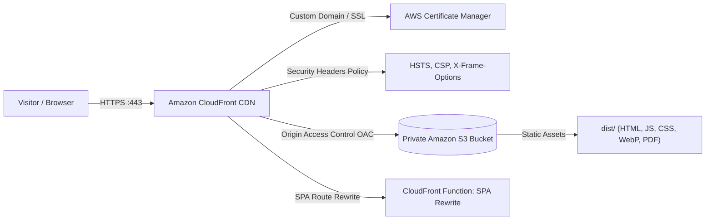

# AWS S3 & CloudFront Hosting Architecture for Harsh Portfolio

This guide outlines the production hosting setup for Harsh Kumar Shandilya's portfolio using **Amazon S3** (private object storage origin) and **Amazon CloudFront** (global CDN distribution with HTTPS and edge security).

---

## 🏛️ Architecture Overview

* **Zero Public S3 Access:** The S3 bucket has *Block all public access* enabled. Objects can only be retrieved by CloudFront through Origin Access Control (OAC).
* **Ultra-Fast Global Caching:** Hashed assets (`/assets/*.js`, `/assets/*.css`) are cached for 1 year with `immutable`. `index.html` is validated immediately (`max-age=0, must-revalidate`).
* **SPA Routing:** Clean routes (e.g. `/projects`, `/about`) are routed seamlessly to `/index.html` without breaking browser history.

---

## 📋 Step-by-Step AWS Console Setup Guide

### 1. Create the Private S3 Bucket
1. Open the [Amazon S3 Console](https://s3.console.aws.amazon.com/).
2. Click **Create bucket**.
3. **Bucket name**: e.g., `harsh-portfolio-frontend` (must be globally unique).
4. **AWS Region**: Choose your preferred region (e.g., `ap-south-1` Mumbai or `us-east-1` N. Virginia).
5. **Block Public Access**: Keep **Block *all* public access** checked ✅ (DO NOT uncheck).
6. Click **Create bucket**.

---

### 2. Request Free SSL Certificate in AWS Certificate Manager (ACM)
> ⚠️ **Important:** For CloudFront custom domains, the ACM certificate **MUST** be requested in the **`us-east-1` (N. Virginia)** region.

1. Switch region in the top navigation bar to **US East (N. Virginia) `us-east-1`**.
2. Open [AWS Certificate Manager (ACM)](https://console.aws.amazon.com/acm/).
3. Click **Request certificate** -> **Request a public certificate**.
4. Fully qualified domain name: `yourdomain.com` and `*.yourdomain.com`.
5. Validation method: **DNS validation** (recommended).
6. Click **Request** and add the generated CNAME records to your DNS provider (e.g., Route 53 or GoDaddy).

---

### 3. Create CloudFront Distribution with Origin Access Control (OAC)
1. Open [Amazon CloudFront Console](https://console.aws.amazon.com/cloudfront/).
2. Click **Create distribution**.
3. **Origin domain**: Select your S3 bucket from the dropdown (e.g., `harsh-portfolio-frontend.s3.ap-south-1.amazonaws.com`).
4. **Origin access**: Select **Origin access control settings (recommended)**.
   * Click **Create control setting** -> Name: `harsh-portfolio-oac` -> Click **Create**.
5. **Default cache behavior**:
   * **Viewer protocol policy**: **Redirect HTTP to HTTPS**.
   * **Allowed HTTP methods**: `GET, HEAD`.
   * **Cache policy**: `CachingOptimized` (managed policy).
   * **Response headers policy**: Select `SecurityHeadersPolicy` or create one using `aws/cloudfront-response-headers-policy.json`.
6. **Web Application Firewall (WAF)**: Select *Do not enable security protections* (unless you have specific enterprise requirements).
7. **Settings**:
   * **Alternate domain names (CNAMEs)**: Enter `yourdomain.com` and `www.yourdomain.com`.
   * **Custom SSL certificate**: Select the certificate requested in ACM (`us-east-1`).
   * **Default root object**: Type `index.html`.
8. Click **Create distribution**.

---

### 4. Apply the S3 Bucket Policy
Once the distribution is created, CloudFront will show a yellow banner: *"The S3 bucket policy needs to be updated."*
1. Click **Copy policy** (or use [aws/s3-bucket-policy.json](./s3-bucket-policy.json)).
2. Go to your S3 bucket -> **Permissions** tab -> **Bucket policy** -> Click **Edit**.
3. Paste the policy and click **Save changes**.

---

### 5. Configure Single Page Application (SPA) Routing

Choose either **Method A** (easiest in console) or **Method B** (recommended for production):

#### Method A: Custom Error Responses (2 clicks in AWS Console)
1. In your CloudFront distribution, go to the **Error pages** tab.
2. Click **Create custom error response**:
   * **HTTP error code**: `403: Forbidden`
   * **Customize error response**: Yes
   * **Response page path**: `/index.html`
   * **HTTP response code**: `200: OK`
   * Click **Create custom error response**.
3. Repeat the exact same step for `404: Not Found` (Path: `/index.html`, Response: `200: OK`).

#### Method B: CloudFront Function URL Rewrite
1. In CloudFront Console, go to **Functions** (left sidebar) -> Click **Create function**.
2. Name: `spa-rewrite` -> Runtime: `cloudfront-js-2.0`.
3. Paste the contents of [aws/cloudfront-viewer-request.js](./cloudfront-viewer-request.js).
4. Click **Save changes** -> Click **Publish**.
5. Associate the function with your distribution:
   * Event type: **Viewer Request**.
   * Distribution: Select your distribution -> Cache behavior: `Default (*)`.
   * Click **Add association**.

---

### 6. Point DNS to CloudFront
* In **Route 53** (or your DNS provider):
  * Create an **A Record** (Alias) for your domain pointing to the CloudFront distribution domain name (e.g. `d123456abcdef8.cloudfront.net`).
  * Create a **CNAME Record** for `www` pointing to the same distribution.

